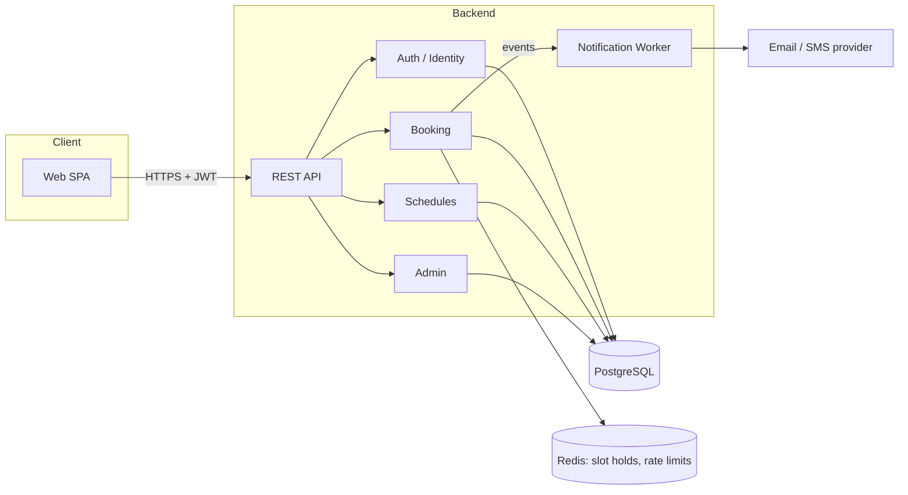
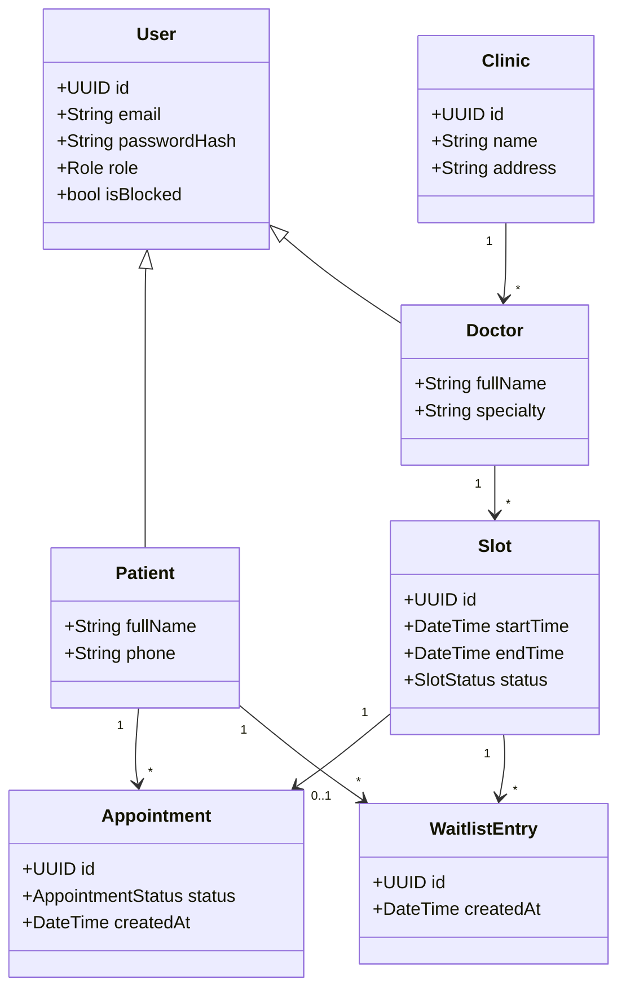
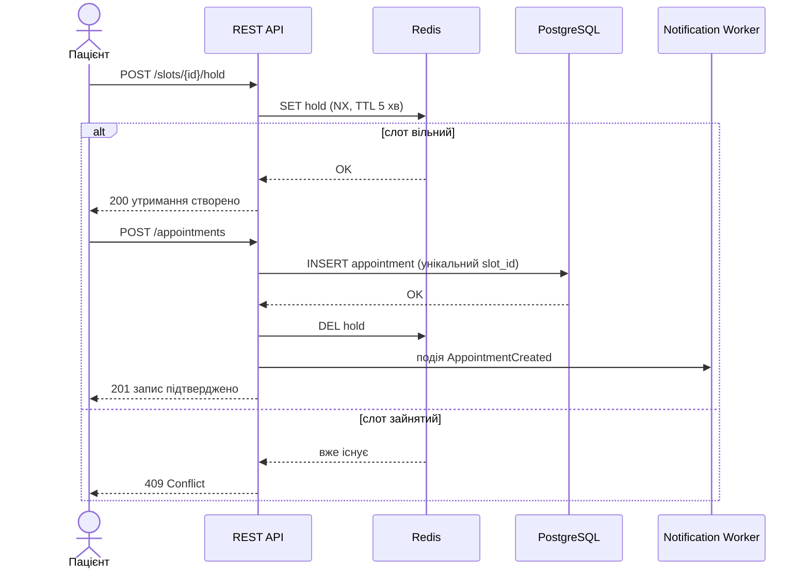
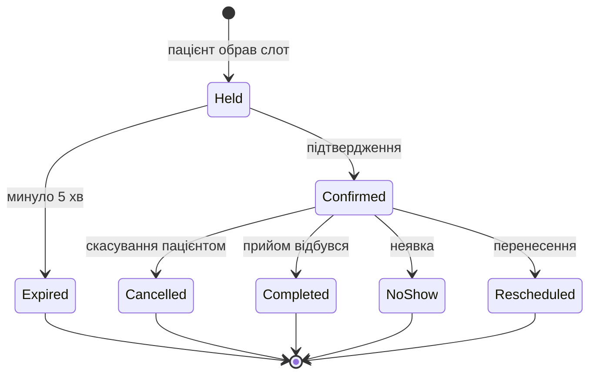

# MedSlot: Software Requirements Specification (SRS)

**Проєкт:** MedSlot, веб-застосунок для онлайн-запису пацієнтів до лікарів
**Курс:** Об'єктно-орієнтований аналіз і проєктування ПЗ
**Версія:** 1.0

---

## 1. Вступ

### 1.1 Призначення
MedSlot дозволяє пацієнтам самостійно знаходити лікаря, переглядати вільні часові слоти та записуватися на прийом. Лікарі ведуть свій графік, а адміністратор клініки керує лікарями, розкладами та правилами запису.

### 1.2 Проблема
Запис до лікаря телефоном займає час, а реєстратура працює обмежені години. Без єдиної системи виникають подвійні записи на один час, незаписані скасування й пропущені прийоми.

### 1.3 Межі системи
**Входить:** пошук лікарів, слоти, запис, скасування й перенесення, сповіщення, ролі та керування акаунтами, адміністрування розкладів.
**Не входить:** електронна медична картка, онлайн-оплата, відеоконсультації, інтеграція з лабораторіями.

### 1.4 Словник
| Термін | Значення |
|---|---|
| Слот | Інтервал часу в розкладі лікаря, на який можна записатися |
| Запис (Appointment) | Підтверджене бронювання слоту пацієнтом |
| Утримання (Hold) | Тимчасове блокування слоту на час підтвердження запису |
| Лист очікування | Черга пацієнтів на слот, що вже зайнятий |

---

## 2. Актори та персони

| Актор | Персона | Цілі |
|---|---|---|
| **Пацієнт** | Олена, 28 років, працює в офісі, мало вільного часу | Швидко знайти лікаря й зручний час, записатися без дзвінків, отримати нагадування |
| **Лікар** | Др. Андрій, терапевт, веде 20 прийомів на день | Бачити свій графік, закривати час, відмічати неявки |
| **Адміністратор клініки** | Марина, керівник реєстратури | Керувати лікарями й розкладами, блокувати порушників, переглядати статистику |
| **Система сповіщень** (зовнішній) | Email/SMS-провайдер | Доставляти підтвердження й нагадування |

---

## 3. Функціональні вимоги

| ID | Вимога | Актор | Пріоритет |
|---|---|---|---|
| FR-01 | Користувач може зареєструватися з email і паролем та підтвердити email | Пацієнт | Високий |
| FR-02 | Користувач може увійти в систему та вийти з неї | Усі | Високий |
| FR-03 | Пацієнт може шукати лікарів за спеціальністю, прізвищем і клінікою | Пацієнт | Високий |
| FR-04 | Система показує вільні слоти лікаря на обрану дату | Пацієнт | Високий |
| FR-05 | Пацієнт може записатися на вільний слот; при одночасному виборі одного слоту запис отримує лише один пацієнт | Пацієнт | Високий |
| FR-06 | Система тимчасово утримує обраний слот на 5 хвилин до підтвердження запису | Система | Високий |
| FR-07 | Пацієнт може скасувати запис не пізніше ніж за 2 години до прийому | Пацієнт | Високий |
| FR-08 | Пацієнт може перенести запис на інший вільний слот | Пацієнт | Середній |
| FR-09 | Пацієнт може переглянути історію й майбутні записи | Пацієнт | Середній |
| FR-10 | Лікар може переглядати свій розклад і записи на день | Лікар | Високий |
| FR-11 | Лікар може закрити слот (відпустка, перерва) та відмітити неявку пацієнта | Лікар | Середній |
| FR-12 | Адміністратор може створювати й редагувати профілі лікарів та їхні розклади | Адміністратор | Високий |
| FR-13 | Адміністратор може блокувати й розблоковувати акаунт пацієнта | Адміністратор | Середній |
| FR-14 | Система надсилає email-підтвердження запису та нагадування за 24 години | Система сповіщень | Середній |
| FR-15 | Пацієнт може стати в лист очікування на зайнятий слот і отримати сповіщення, якщо слот звільнився | Пацієнт | Низький |
| FR-16 | Адміністратор може переглядати статистику записів (кількість, неявки, завантаженість лікарів) | Адміністратор | Низький |

---

## 4. Нефункціональні вимоги

| ID | Категорія | Вимога |
|---|---|---|
| NFR-01 | Продуктивність | 95% запитів на перегляд слотів виконуються швидше за 500 мс при 200 одночасних користувачах |
| NFR-02 | Коректність даних | Один слот не може мати двох підтверджених записів (захист від гонок на рівні БД) |
| NFR-03 | Безпека | Паролі зберігаються лише як хеш (bcrypt/argon2), комунікація лише по HTTPS |
| NFR-04 | Безпека | Пацієнт бачить лише власні записи; доступ до даних перевіряється за роллю на кожному запиті |
| NFR-05 | Доступність | Доступність сервісу не менше 99% на місяць за винятком планових робіт |
| NFR-06 | Стійкість | Недоступність сервісу сповіщень не блокує запис: сповіщення йдуть через чергу з повторами |
| NFR-07 | Захист від зловживань | Не більше 60 запитів на хвилину на користувача і 20 спроб входу на хвилину з однієї IP-адреси |
| NFR-08 | Зручність | Інтерфейс адаптивний і працює на мобільних екранах від 360 px |
| NFR-09 | Аудит | Створення, скасування й зміни записів та адмін-дій журналюються з часом і автором |

---

## 5. Керування ідентичністю (Identity Management)

- **Реєстрація:** email + пароль 12–128 символів, підтвердження email за одноразовим посиланням. Публічна реєстрація завжди створює роль «Пацієнт».
- **Ролі (RBAC):** `PATIENT`, `DOCTOR`, `CLINIC_ADMIN`. Облікові записи лікарів і адміністраторів створює лише адміністратор.
- **Автентифікація:** вхід за email і паролем, видача короткоживучого access-токена (15 хв) і refresh-токена (7 днів) з можливістю відкликання.
- **Захист від перебору паролів:** після 5 невдалих спроб підряд вхід тимчасово блокується.
- **Авторизація:** кожен endpoint перевіряє роль і належність ресурсу (пацієнт працює лише зі своїми записами, лікар лише зі своїм графіком).
- **Блокування:** адміністратор може заблокувати акаунт; активні токени такого користувача відкликаються.
- **Зберігання секретів:** паролі лише у вигляді хешу, токени не журналюються.

---

## 6. Архітектура високого рівня

Обрано **модульний моноліт** з окремим фоновим воркером для сповіщень. Для прототипу це простіше за мікросервіси, але модулі мають чіткі межі й за потреби розділяються.

| Компонент | Призначення |
|---|---|
| Web SPA | Інтерфейс пацієнта, лікаря й адміністратора |
| REST API | Єдина точка входу, перевірка токенів, валідація |
| Auth | Реєстрація, вхід, ролі, токени |
| Booking | Слоти, утримання, запис, скасування, лист очікування |
| Schedules | Розклади лікарів |
| Notification Worker | Асинхронні сповіщення з повторами |
| PostgreSQL | Основне сховище, унікальність запису на слот |
| Redis | Тимчасове утримання слотів, лічильники rate limit |

---

## 7. UML-моделі

### 7.1 Діаграма класів (основні сутності)

### 7.2 Діаграма послідовності: запис на слот

### 7.3 Діаграма станів запису

---

## 8. Припущення й обмеження

- Один часовий пояс на всю клініку.
- Тривалість слоту фіксована (задається в розкладі лікаря).
- Прототип розрахований на одну клініку; підтримка мережі клінік залишена на майбутнє.
- Сповіщення надсилаються лише на email.
