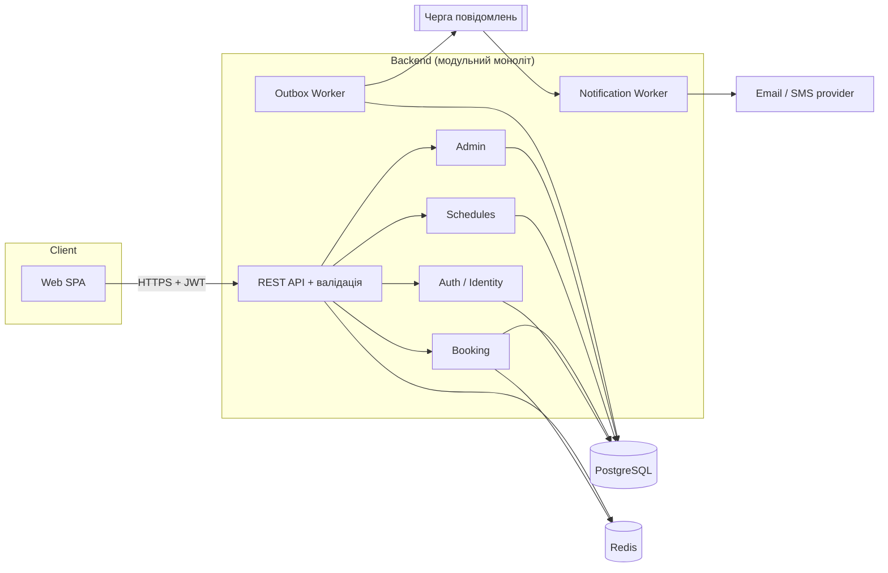
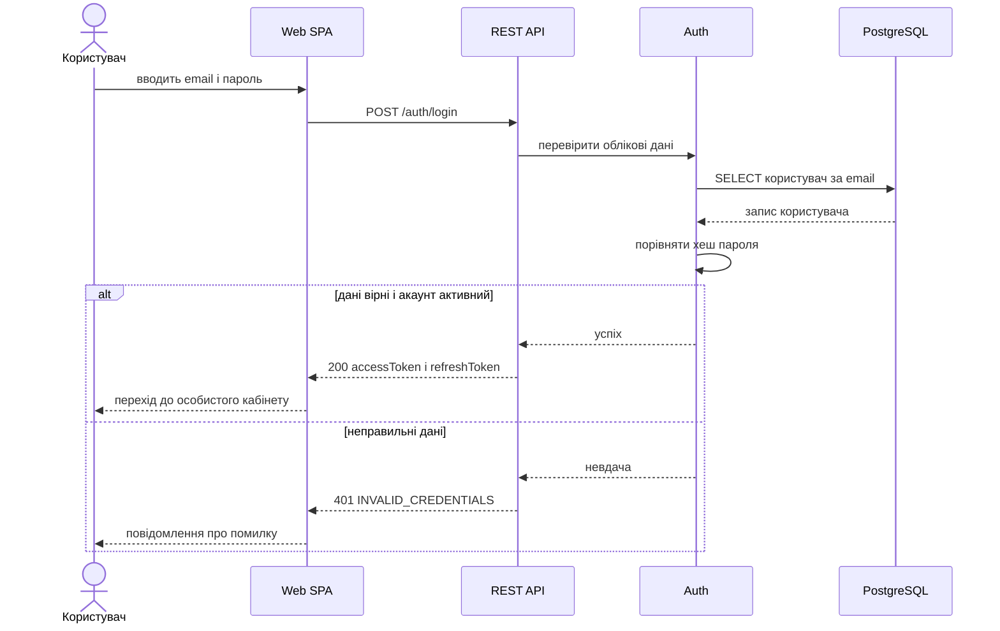
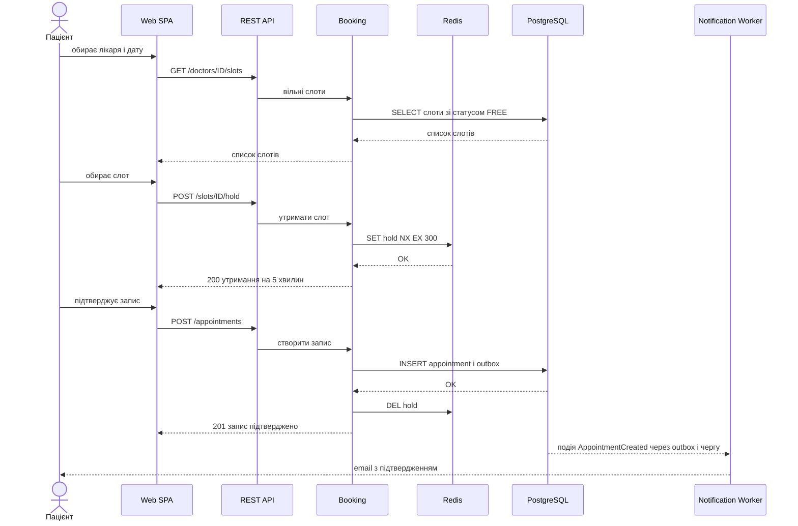
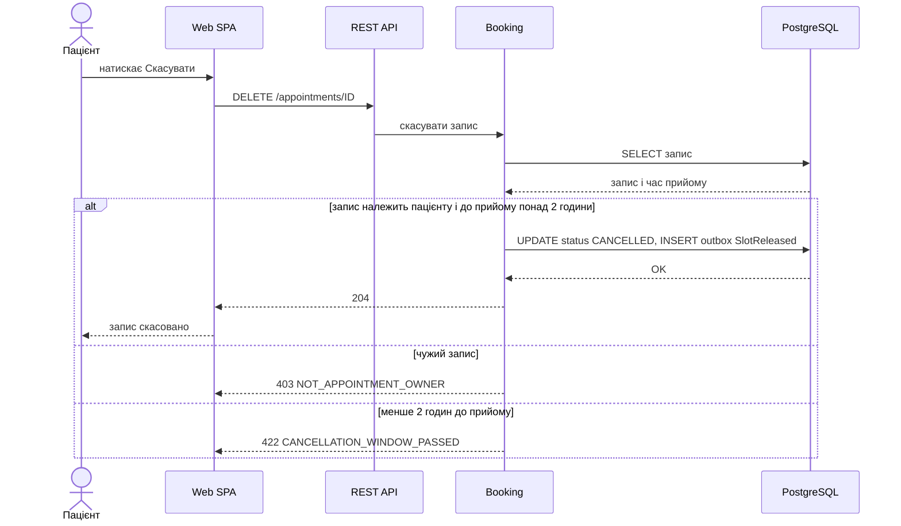

# MedSlot: Архітектура

## 1. Класифікація архітектури

| Вимір | Вибір | Обґрунтування |
|---|---|---|
| Стиль бекенду | **Модульний моноліт** | Один сервіс розгортається разом, але код поділений на модулі з чіткими межами. Для одного розробника й однієї клініки простіше за мікросервіси, а за потреби модуль можна виділити окремо |
| Клієнт | **SPA** (single page application) | Динамічний вибір слотів без перезавантаження сторінки |
| Взаємодія | **REST + JSON** над HTTPS | Просто, добре документується через OpenAPI |
| Асинхронна частина | **Фоновий воркер + черга** | Сповіщення й обробка листа очікування не повинні гальмувати запис |
| Дані | **PostgreSQL** (основне сховище) + **Redis** (тимчасові дані) | Реляційна модель для записів, швидкі атомарні ключі для утримання слотів і лічильників |
| Розгортання | Docker-контейнери (деталі в окремому документі Deployment model) | Однаковий запуск у розробці й на сервері |

### Чому не мікросервіси
Мікросервіси дають незалежне масштабування й розгортання, але додають мережеві збої, розподілені транзакції та складну інфраструктуру. Для MedSlot основне навантаження зосереджене в одному модулі (Booking), тому виграш мінімальний. Межі модулів (нижче) залишають можливість розділення пізніше.

## 2. Діаграма компонентів

## 3. Модулі та відповідальності

| Модуль | Відповідає за | Залежить від |
|---|---|---|
| **REST API** | Маршрутизація, перевірка токена, валідація, єдиний формат помилок, rate limiting | Auth, Redis |
| **Auth / Identity** | Реєстрація, вхід, ролі, токени, блокування акаунтів | PostgreSQL |
| **Booking** | Слоти, утримання, запис, скасування, перенесення, лист очікування | PostgreSQL, Redis |
| **Schedules** | Розклади лікарів, закриття слотів | PostgreSQL |
| **Admin** | Лікарі, клініка, блокування, статистика | PostgreSQL |
| **Outbox Worker** | Передача подій із таблиці `outbox` у чергу | PostgreSQL, черга |
| **Notification Worker** | Надсилання email, повтори, обробка збоїв | Черга, провайдер |

Модулі не звертаються до таблиць один одного напряму, лише через інтерфейси модулів.

## 4. Ключові архітектурні рішення

| Рішення | Альтернатива | Причина вибору |
|---|---|---|
| Redis для утримання слотів | Блокування рядків у БД | Швидше, TTL автоматично знімає утримання; БД усе одно має унікальний індекс як остання гарантія |
| Transactional Outbox для подій | Пряма відправка в чергу з API | Подія не губиться, якщо сервіс падає між зміною даних і публікацією |
| Короткоживучі JWT (15 хв) + refresh-токени | Серверні сесії | Клієнт без стану на кожному запиті, а refresh можна відкликати |
| Єдиний формат помилок | Різні формати по модулях | Клієнт обробляє всі помилки однаково, див. [error-handling.md](error-handling.md) |

## 5. Діаграми послідовності

### 5.1 Вхід у систему

### 5.2 Запис до лікаря (успішний сценарій)

### 5.3 Скасування запису

Додаткові діаграми послідовності, пов'язані з паралельною роботою (гонка за слот, Saga перенесення, Outbox, ретраї), описано в [concurrency.md](concurrency.md).
