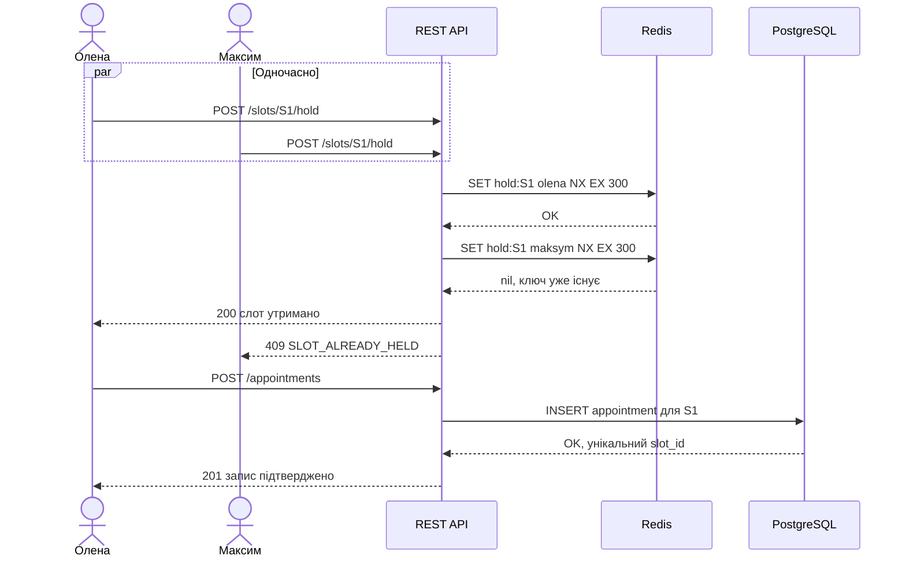
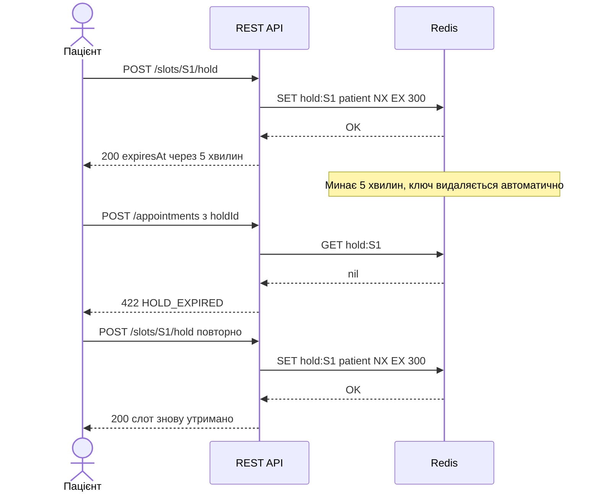
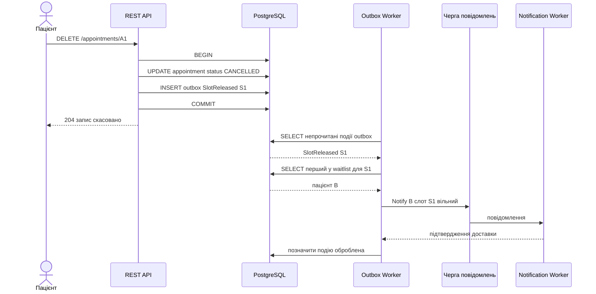
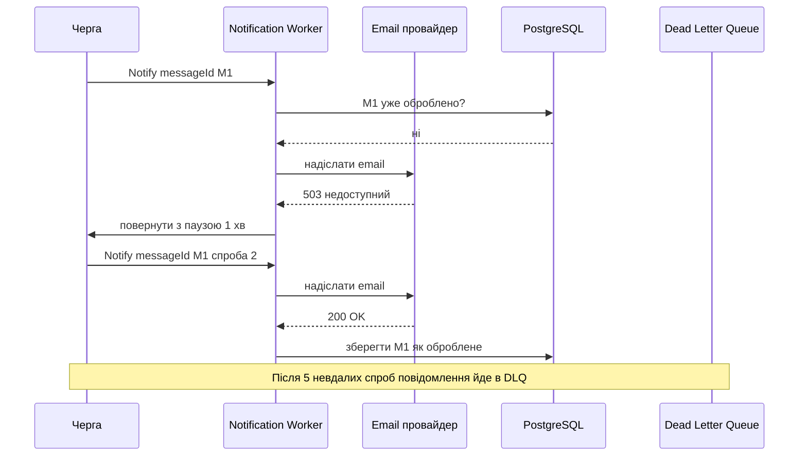
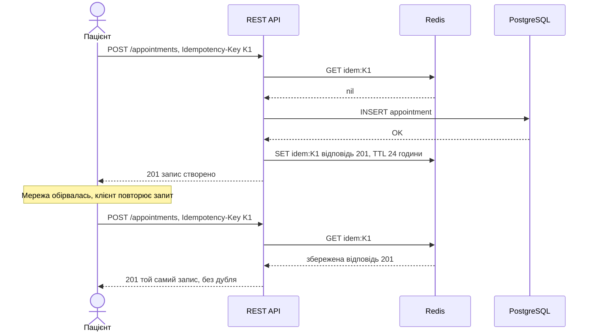
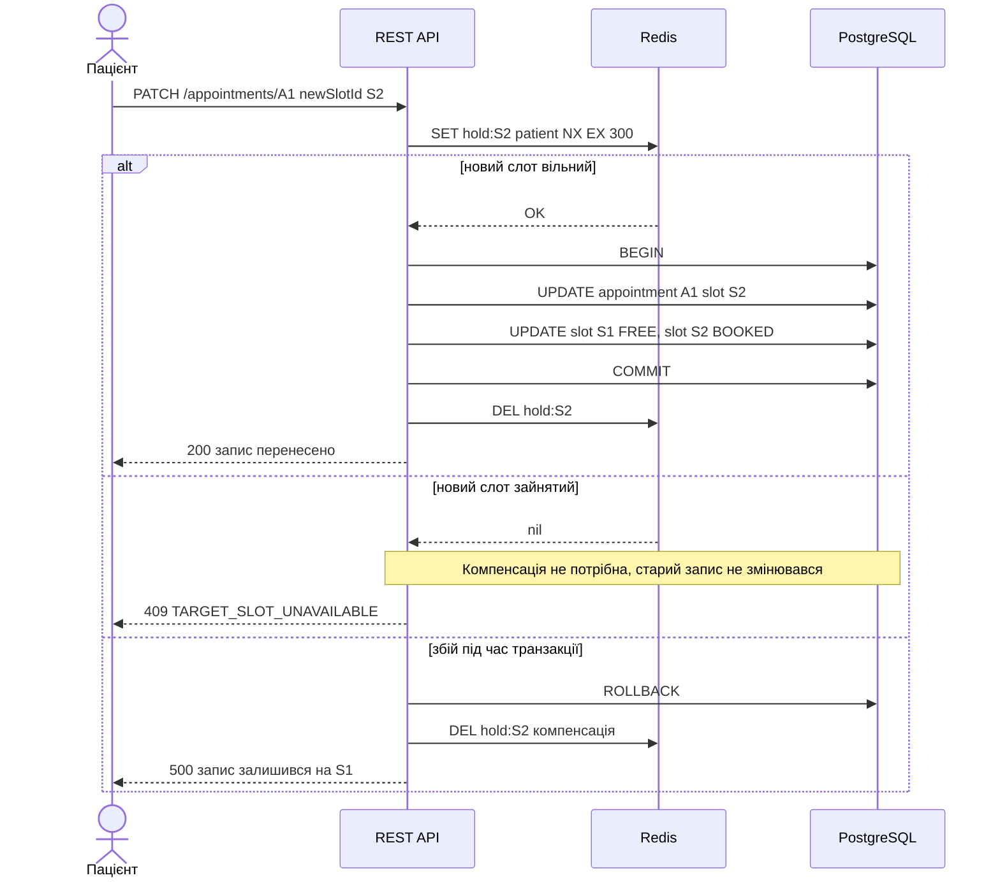
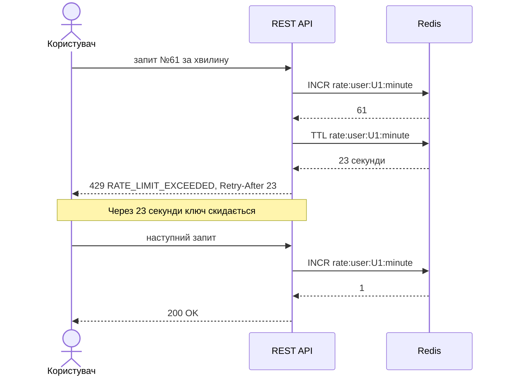

# MedSlot: Concurrency and Distributed Patterns Usage

У MedSlot багато користувачів змагаються за обмежені ресурси (слоти лікарів), а частина роботи виконується асинхронно (сповіщення, лист очікування). У документі описано **7 сценаріїв**, діаграми послідовності для них і патерни, які ці проблеми розв'язують.

| # | Сценарій | Проблема | Патерн |
|---|---|---|---|
| 1 | Два пацієнти обирають один слот | Race condition, подвійний запис | Distributed lock (Redis `SET NX`) + Unique constraint |
| 2 | Закінчення утримання слоту | Слот «завис» після відмови пацієнта | Timeout / TTL |
| 3 | Скасування запису і лист очікування | Слот звільнився, потрібно передати наступному | Transactional Outbox + Producer/Consumer |
| 4 | Надсилання сповіщень | Збій зовнішнього провайдера | Message Queue + Retry з backoff + Idempotent Consumer |
| 5 | Повторний запит запису (подвійний клік, обрив мережі) | Дублювання запису | Idempotency Key |
| 6 | Перенесення запису | Старий слот не можна втратити, якщо новий зайнятий | Saga з компенсацією |
| 7 | Спам запитів | Перевантаження, боти займають слоти | Rate Limiting (Fixed window у Redis) |

Спільний принцип: **швидка перевірка в Redis відсікає більшість конфліктів, а остаточну гарантію коректності дає база даних** (унікальний індекс). Якщо Redis недоступний, система працює повільніше, але не порушує коректність.

---

## Потік 1. Два пацієнти обирають один слот

**Проблема.** Олена й Максим одночасно натискають «Обрати» на слоті 10:00. Без захисту обидва могли б отримати підтверджений запис.

**Рішення.** Перший запит атомарно встановлює ключ `hold:{slotId}` у Redis командою `SET ... NX EX 300`. Другий бачить, що ключ існує, і отримує `409`. Додатково в PostgreSQL є унікальний індекс на `slot_id` для підтверджених записів як остання лінія захисту.

**Чому саме так.** Операція `SET NX` атомарна, тому вибір переможця відбувається без блокувань у застосунку. Утримання не дає двом пацієнтам одночасно заповнювати форму для одного слоту, а унікальний індекс захищає навіть у разі збою Redis чи помилки в коді.

---

## Потік 2. Закінчення утримання слоту

**Проблема.** Пацієнт утримав слот і закрив вкладку. Слот має знову стати доступним, а не блокуватись назавжди.

**Рішення.** Ключ має TTL 5 хвилин, тож Redis сам видаляє його. При підтвердженні система перевіряє, що утримання ще належить цьому пацієнту.

**Чому саме так.** TTL усуває потребу в окремому фоновому процесі очищення і гарантує, що відмова одного клієнта не блокує інших.

---

## Потік 3. Скасування запису і лист очікування

**Проблема.** Після скасування слот потрібно запропонувати першому в черзі, і при цьому не втратити подію, якщо сервіс упаде між зміною запису та відправкою повідомлення.

**Рішення.** Скасування й запис події в таблицю `outbox` виконуються в **одній транзакції БД**. Окремий воркер читає `outbox` і передає слот наступному в черзі (Transactional Outbox). Подія гарантовано не загубиться.

**Чому саме так.** Без Outbox сервіс міг би скасувати запис, але впасти до публікації події, і слот так і не дістався б наступному пацієнту. Транзакція робить обидві дії атомарними.

---

## Потік 4. Надсилання сповіщень зі збоями

**Проблема.** Email-провайдер тимчасово недоступний, але запис пацієнта від цього не повинен ламатись (NFR-06).

**Рішення.** Сповіщення йдуть через чергу. При збої воркер повторює спробу з експоненційною паузою (1 хв, 2 хв, 4 хв). Після 5 невдач повідомлення потрапляє в Dead Letter Queue. Повідомлення мають унікальний `messageId`, тому повторна доставка не створює дублів (Idempotent Consumer).

**Чому саме так.** Черга відділяє запис від доставки (Queue-Based Load Leveling), а перевірка `messageId` гарантує, що пацієнт не отримає кілька однакових листів.

---

## Потік 5. Повторний запит запису

**Проблема.** Пацієнт двічі натиснув «Підтвердити» або мережа обірвалась, і клієнт повторив запит. Не можна створити два записи.

**Рішення.** Клієнт передає заголовок `Idempotency-Key`. Сервер зберігає результат за цим ключем, і повторний запит із тим самим ключем повертає збережену відповідь замість створення нового запису.

**Чому саме так.** Клієнт може безпечно повторювати запит скільки завгодно разів. Якщо той самий ключ приходить з іншим тілом запиту, сервер повертає `422`.

---

## Потік 6. Перенесення запису (Saga)

**Проблема.** Перенесення складається з двох кроків: зайняти новий слот і звільнити старий. Якщо новий слот уже зайнятий, пацієнт не повинен втратити свій поточний запис.

**Рішення.** Saga з компенсацією. Спершу утримується **новий** слот. Старий слот звільняється лише після успішного підтвердження нового. Якщо крок невдалий, виконується компенсація і поточний запис лишається без змін.

**Чому саме так.** Порядок «спочатку захопити новий, потім звільнити старий» гарантує, що пацієнт ніколи не лишається без запису. Компенсація (`DEL hold`, `ROLLBACK`) повертає систему до початкового стану.

---

## Потік 7. Захист від спаму запитів

**Проблема.** Бот або помилковий клієнт надсилає сотні запитів на утримання слотів і займає їх, не підтверджуючи (NFR-07).

**Рішення.** Rate limiting за схемою Fixed Window у Redis: лічильник на користувача на кожну хвилину. Понад 60 запитів повертає `429` із заголовком `Retry-After`. Для входу окремий ліміт: 20 спроб на хвилину з однієї IP.

**Чому саме так.** Лічильник у Redis спільний для всіх екземплярів API, тому ліміт діє незалежно від того, який сервер обробив запит. Захищає також від перебору паролів.

---

## Підсумок

- **Коректність** забезпечують атомарні операції Redis (потоки 1, 2, 7) та унікальний індекс БД (потік 1).
- **Надійність доставки** забезпечують Outbox і черга з повторами (потоки 3, 4).
- **Безпечні повтори** забезпечує Idempotency Key (потік 5).
- **Узгодженість між кількома кроками** забезпечує Saga (потік 6).
